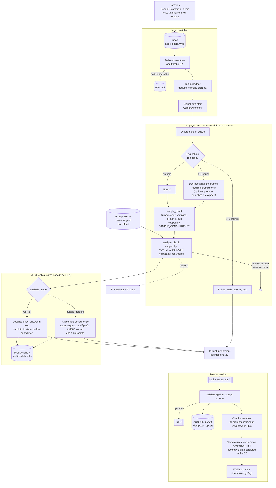
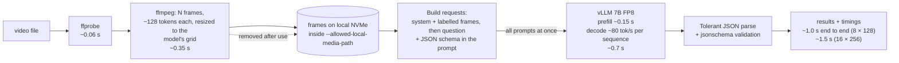

# vlmpipe architecture

Mermaid diagrams (rendered by GitHub). Numbers are measured on one L40S with Qwen2.5-VL-7B FP8,
vLLM 0.33, cold prefix cache. Details and caveats: `video_inference_pipeline_architecture_v2.md` §11.

## 1. Camera-stream pipeline

## 2. Single video, minimum latency (`python -m vlmpipe.fast`)

Why these choices (measured): guided JSON degraded the 7B's output, so the schema goes in the
prompt; a warm request costs about what it saves below ~3000 visual tokens; `-hwaccel cuda` is
slower on short clips; speculative n-gram decoding and the 3B model gave no gain.
