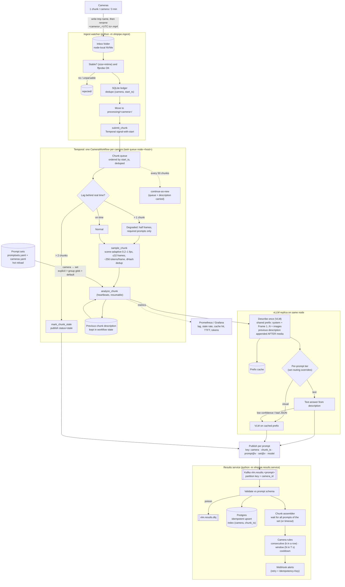

# High-Performance Video & Multimodal Inference Pipeline — v2
## Reviewed and revised architecture blueprint

> v2 of the Gemini draft. The core idea is kept: decode once, bundle prompts, reuse the prefix. Section 0 lists what was wrong or missing in v1. The rest is the corrected design.

---

## 0. Review of v1: what changed and why

| # | v1 claim / gap | Problem | v2 fix |
|---|---|---|---|
| 1 | "vLLM executes the vision tower **once**; subsequent prompts hit the cache" | It only holds if the prompts reach the engine **one after another**. A bundle submitted all at once lands in the same scheduler step. Each request misses the prefix cache, because the KV blocks are only cached after prefill finishes, so the ViT and the prefill can run N times. | **Warm-then-fan-out**: send one prefix-only request (`max_tokens=1`), wait for it, then send the N prompts (§4.3). |
| 2 | Media path in the prompt is the "prefix" | The path is not part of the token prefix. The prefix is the chat-template tokens, the system prompt and the image placeholder tokens. vLLM hashes those together with the image **content** hash. Any difference before the image (timestamp, request-id, a different system prompt per use case) breaks reuse. | Use one canonical shared prefix: the same system prompt and the media placed first. Everything that varies by use case goes **after** the media (§4.2). |
| 3 | DALI → write JPEG → vLLM reads JPEG | GPU decode, then a CPU JPEG re-encode, then a CPU JPEG decode in vLLM, then the HF processor resizes again on CPU. This throws away most of the DALI gain and adds compression loss, which hurts OCR. | Resize to the **model processor's exact target grid** so the processor doesn't resize again. Store frames losslessly or at high quality, or go further and pass **precomputed embeddings** (§4.1, §7). |
| 4 | "Resize to 448×448" | Qwen2-VL uses dynamic resolution: dimensions are multiples of 28 and token count is bounded by `min_pixels`/`max_pixels`. A fixed square distorts aspect ratio and wastes tokens. | Derive the size from the model's processor config and budget the tokens per frame (§4.1). |
| 5 | `fn.readers.video` handles "Video File / RTSP Stream" | The DALI video reader works on files. It does not ingest RTSP. | Live streams: use GStreamer/DeepStream or PyNvVideoCodec to decode, then chunk into segments. Files: use DALI (§4.1). |
| 6 | `sequence_length` + `stride` for "1–2 FPS sampling" | Those parameters build clips of consecutive frames. They don't sample uniformly across the video. NVDEC also still has to decode the reference frames, so the stride saves downstream work, not decode work. | Use explicit frame-index / keyframe sampling. Benchmark decode cost separately from sampling. |
| 7 | `/dev/shm` or "RWX local NVMe PVC" as a shared bus | `/dev/shm` is per pod/node. Local NVMe is ReadWriteOnce. Neither is shared across a cluster. | **Node affinity**: ingest and vLLM run on the same node and share a hostPath/emptyDir. Object storage is the durable fallback. Add TTL and garbage collection (§5). |
| 8 | "vLLM cluster" with no routing story | The prefix cache is **per replica**. Round-robin load balancing sends the bundle to different replicas, so the cache never hits. | **Cache-affinity routing**: consistent-hash on `video_id`, or a KV-aware router such as vLLM production-stack or llm-d (§4.4). |
| 9 | Temporal **or** Ray **plus** Redis Streams **plus** Kafka/RabbitMQ | Four coordination systems for one pipeline. | Use one durable workflow engine for control flow and one event bus for results (§2). |
| 10 | "Stream tokens downstream" | Business logic needs a complete, valid result, not token fragments. | Stream **completed per-prompt results** as they finish. Enforce JSON-schema structured output (§4.3). |
| 11 | "~3×–8× TTFT reduction" | Not measured. The real gain depends on what fraction of the prompt is shared (image tokens vs. question tokens) and on cache eviction under load. | Treat it as a hypothesis and **validate it in week 1** (§8). |
| 12 | Missing topics | Backpressure, GPU sharing between DALI and vLLM, idempotency, KV eviction, accuracy evaluation, security of local media access, cost model. | §5–§7. |

---

## 1. Problem & approach (unchanged in spirit)

Several use cases (safety, OCR, action tagging, summary) query the **same** video. A naive design repeats the decode, the network transfer and the ViT encoding for every use case.

**v2 approach:**
1. **Decode once** on the GPU, and only at the sample points you need.
2. **Encode once.** ViT runs once per frame set. Prefill of the shared prefix also runs once per frame set.
3. **Ask many.** Use-case prompts are appended after a byte-identical shared prefix on the **same replica**.

---

## 2. Technology stack (simplified)

| Layer | Choice | Notes |
|---|---|---|
| File decode | **NVIDIA DALI** (`fn.readers.video` / experimental video decoder) | NVDEC plus GPU resize. |
| Live stream decode | **GStreamer + nvv4l2decoder / DeepStream** or **PyNvVideoCodec** | Chunk into N-second segments, which then follow the file path. |
| Frame store | Node-local NVMe (hostPath) + **S3/MinIO** fallback | Key frames by `sha256(content)`. Apply a TTL. |
| Control flow | **Temporal** (one choice) | Durable per-video workflow: retries, deadlines, partial completion. |
| Model serving | **vLLM** (Qwen2.5-VL / Qwen2-VL etc.) with prefix caching | V1 engine, where prefix caching is on by default. |
| Routing | Consistent hash on `video_id`, or a KV-aware router | Required for cache hits. |
| Results bus | **Kafka** (one choice) | One topic per result type, keyed by `video_id`. |
| Observability | Prometheus + OpenTelemetry traces | Propagate `video_id` as the trace ID end to end. |

---

## 3. Architecture flow (as implemented: camera streams)

Each camera produces one ~3-minute chunk every 3 minutes into an inbox folder. Each camera has its own prompt set.



**How to read it:**
1. **Ingest:** cameras write chunks into the inbox. Each file must be written under a temporary name and renamed when complete. The watcher waits until the file is stable and readable, deduplicates it, moves it to `processing/<camera>/` and signals that camera's workflow.
2. **Per-camera workflow:** one long-lived workflow per camera processes chunks strictly in time order. If it falls more than one chunk behind real time it degrades: half the frames, required prompts only. Beyond two chunks behind, a chunk is marked stale instead of processed late. The previous chunk's description is carried forward so events crossing chunk boundaries are caught.
3. **Analysis:** `bundle` by default: all of the camera's prompts run concurrently on the shared media prefix (a warm request is added only for large prefixes). `two_tier` is available: the VLM describes the chunk once and each prompt is answered from that text, or for pixel-dependent prompts by the VLM on the cached prefix. §11 shows why bundle is the default on a 7B model.
4. **Results:** every answer is published per prompt, keyed by camera. The results service validates and stores it, waits until all of a chunk's prompts have arrived, then evaluates camera-level rules such as "violation in 2 chunks in a row" and sends webhooks.

---

## 4. Layer deep-dives

### 4.1 Decode (DALI)

- **Sample deliberately.** Build an explicit list of frame indices (uniform 1–2 FPS, plus scene-change frames if needed). Don't treat `stride` as a sampler.
- **Resize to the processor's grid.** For Qwen2-VL-style models, both dimensions are rounded to multiples of 28 and the token count is about `(H/28)·(W/28)` per image. Video frames are also merged in temporal pairs. Compute the target size with the same `smart_resize` logic the HF processor uses, then pass sizes that won't be resized again.
- **Token budget.** 32 frames × ~300 tokens each is roughly 10k prompt tokens. Pick `max_pixels` and the frame count to fit both `max_model_len` and your KV budget. This choice dominates both cost and cache pressure.
- **Format.** Use PNG or high-quality JPEG. At q≈75, JPEG artifacts measurably hurt OCR. Measure accuracy against quality before you optimise bytes.
- **GPU sharing.** NVDEC is separate silicon, but DALI buffers use the same HBM as vLLM. Either cap vLLM `--gpu-memory-utilization` (e.g. 0.80) and set DALI memory pools explicitly, or decode on a separate GPU/MIG slice.

```python
from nvidia.dali import pipeline_def, fn, types

@pipeline_def(batch_size=1, num_threads=4, device_id=0)
def frames_pipe(files, H, W):
    # sequence_length=1 + explicit sampling is done upstream by choosing frame indices / segments
    video = fn.readers.video(device="gpu", filenames=files, sequence_length=1,
                             file_list_include_preceding_frame=True, name="reader")
    return fn.resize(video, resize_x=W, resize_y=H, interp_type=types.INTERP_CUBIC)
```
*(Treat this as a sketch. Check the reader arguments against your DALI version. The newer `fn.experimental.decoders.video` / `fn.experimental.inputs.video` give finer control over which frames are decoded.)*

### 4.2 Bundling: the canonical prefix

The cache key is the **token sequence plus the image content hashes**, in order. Build every request in a bundle like this:

```
[system: FIXED shared system prompt]          <- identical for every use case
[user:   <frames 1..K in fixed order>]        <- identical content, identical order, identical sizes
[user:   use-case instruction + JSON schema]  <- varies (suffix)
```

Rules:
- No timestamps, request IDs or per-use-case personas **before** the media.
- Pin the model revision, the chat template and the processor kwargs (`min_pixels`/`max_pixels`, fps). Changing any of them changes the tokens.
- **Alternative to compare:** one merged prompt that asks every question and returns a single JSON object. It's cheaper (one decode stream), but use cases are coupled, failures are shared, and quality drops when the prompt is long. Default to N suffixes, and merge the cheap classification-style questions.

### 4.3 Execution: warm-then-fan-out

```python
import asyncio
from openai import AsyncOpenAI
client = AsyncOpenAI(base_url=REPLICA_URL, api_key="x")   # REPLICA_URL chosen by affinity router

def msgs(frames, suffix=None):
    content = [{"type": "image_url", "image_url": {"url": f"file://{p}"}} for p in frames]
    m = [{"role": "system", "content": SHARED_SYSTEM},
         {"role": "user", "content": content}]
    if suffix:
        m.append({"role": "user", "content": suffix})
    return m

async def run_bundle(frames, prompts):
    # A) warm: populates encoder output + prefix KV once
    await client.chat.completions.create(model=MODEL, messages=msgs(frames), max_tokens=1)
    # B) fan-out: all N should now hit the prefix cache
    async def one(p):
        r = await client.chat.completions.create(
            model=MODEL, messages=msgs(frames, p.text), max_tokens=p.max_tokens,
            temperature=0, extra_body={"guided_json": p.schema})
        return p.id, r.choices[0].message.content
    for fut in asyncio.as_completed([one(p) for p in prompts]):
        yield await fut            # publish each completed result to Kafka immediately
```

Caveats:
- The warm step adds one round trip. With a single prompt, skip it.
- Two-turn templates (media turn, then question turn) can insert template tokens differently from a single turn. Check that the shared token prefix really is identical by looking at `vllm:prefix_cache_hits` / per-request `num_cached_tokens`.
- Structured-output parameter names vary across vLLM versions (`guided_json` vs. `structured_outputs`). Pin your version.
- Server flags: `--allowed-local-media-path /frames` (restrict it to that directory only), `--max-model-len` sized to your token budget, `--limit-mm-per-prompt` set to your frame count.

### 4.4 Routing & cache lifetime

- **Affinity.** Hash `video_id` to pick the replica, and pin that replica to the node that holds the frames. On failover, the bundle re-warms on the new replica. That is correct, just slower.
- **Eviction.** Prefix KV is LRU. Under load, a bundle's prefix can be evicted between the warm step and the fan-out. Keep the fan-out tight (submit everything immediately after warming), and watch the hit rate against load.
- **Scale beyond one GPU's KV.** Look at KV offload/sharing layers (e.g. LMCache) only after you've shown the single-replica hit rate is good.

---

## 5. Data lifecycle & reliability

- **Content addressing.** Frame key = `sha256(bytes)`. Re-ingesting the same video gives the same keys, so caches hit and writes are idempotent.
- **TTL/GC.** Delete local frames when the workflow completes, or after T minutes. Keep an object-store copy only if replay or audit needs it.
- **Idempotency.** The result key is `(video_id, prompt_id, prompt_version, model_rev)`. Kafka consumers upsert on it.
- **Backpressure.** Temporal limits the number of in-flight bundles per replica based on queue depth (`vllm:num_requests_waiting`). Ingest slows down when the frame store passes a high-water mark.
- **Partial results.** Each prompt has its own deadline. The workflow completes with the results it has and marks the rest `timed_out`. Optional prompts never block required ones.

## 6. Observability (concrete)

| Metric | Source | Why it matters |
|---|---|---|
| Decode FPS, decode latency per segment | DALI worker | Shows whether ingest is the bottleneck. |
| Prefix cache hit rate (hits / queries) | vLLM `/metrics` | The headline KPI. Below ~70% for bundled traffic means a broken prefix or broken routing. |
| Cached tokens per request | vLLM usage (`prompt_tokens_details`) | Per-request proof of reuse. |
| TTFT for warm vs. fan-out requests | Client traces | Validates the speedup claim. |
| KV usage, preemptions, waiting queue | vLLM | Shows eviction and saturation. |
| End-to-end p50/p95 per video, per use case | OTel | Against the SLO. |
| Schema-validation failure rate | Consumer | Output quality. |

## 7. Further optimisations (once the baseline works)

1. **Precomputed vision embeddings.** Run the ViT in a dedicated encoder service, or on the ingest GPU, and pass `image_embeds` to vLLM (supported for some models, e.g. Qwen2-VL). This removes image I/O from the serving path entirely and lets you reuse embeddings across replicas and across days.
2. **Encoder-prefill disaggregation**, available in recent vLLM, when ViT cost dominates.
3. **Frame dedup.** Skip near-identical frames (perceptual hash or embedding similarity). Static cameras often cut tokens by 50%+.
4. **Cascade.** A cheap detector or classifier runs first, and the VLM prompts run only on frames that pass. This is usually the biggest cost lever for safety and anomaly use cases.
5. **Quantisation** (FP8 weights/KV) to fit more cached prefixes per GPU.

## 8. Implementation plan (re-ordered: riskiest assumption first)

**Week 1: APC spike (go/no-go).** Use one vLLM replica, one fixed frame set and five prompts. Measure TTFT, `num_cached_tokens` and ViT time for three cases: (a) concurrent submit, (b) warm-then-fan-out, (c) a single merged prompt. Also measure OCR accuracy against JPEG quality. Every later design choice depends on these numbers.

**Weeks 2–3: Decode service.** File path with DALI. Processor-exact resize. Frame-index sampling. Content-addressed store with TTL. Benchmark against FFmpeg/OpenCV CPU decode at 1080p and 4K. **Stream path:** GStreamer/DeepStream segmenter.

**Weeks 4–5: Orchestration.** Temporal workflow. Versioned prompt registry with a JSON schema per prompt. Canonical prefix builder with a unit test that asserts token-prefix equality across use cases. Per-prompt deadlines and partial completion.

**Week 6: Routing & multi-replica.** Affinity router. Node co-location of ingest and vLLM. Failover re-warm. Hit rate under load.

**Weeks 7–8: Results & hardening.** Kafka consumers with idempotent upserts. Cross-prompt rules. Dashboards (§6). Load test at peak ingest. Accuracy evaluation set per use case with a regression gate on model or prompt changes.

**Exit criteria:** prefix-cache hit rate ≥ X% on bundled traffic, p95 end-to-end ≤ Y s per video minute, GPU-hours per video-hour ≤ Z, per-use-case accuracy ≥ baseline. Set X, Y and Z from the week 1 results.

---

## 9. Concrete profile: batch files, few-minute latency, RTX PRO 6000 / L40S

### 9.1 What this profile implies
- **Throughput first, latency second.** A latency budget of a few minutes means every stage can batch heavily. Batch size is the biggest lever for cost per video-hour.
- **Chunk the videos.** Split each file into 30–60 s segments at keyframes, using `ffmpeg -c copy` (no re-encode). Segments move through the pipeline independently, so latency ≈ the time for one segment plus queueing, not the full video length. Per-video results such as summaries are a reduce step over the segment results.
- **PCIe GPUs, no NVLink.** Avoid tensor parallelism. Run **one model replica per GPU** (data parallel). That also makes cache-affinity routing trivial: one replica means one cache.

### 9.2 GPU fit (vendor specs, verify for your SKU)
| | RTX PRO 6000 (Blackwell) | L40S (Ada) |
|---|---|---|
| Memory | 96 GB | 48 GB |
| FP8 | Yes (FP4 also) | Yes |
| NVDEC | Multiple engines | 3 engines |
| 7B VLM, FP8 | ~8 GB weights → ~75 GB+ left for KV/prefix cache | ~8 GB → ~30 GB for KV |
| Role | Primary serving GPU; can host a 32B-class model in FP8 if quality needs it | Cost-efficient 3–8B serving; good decode boxes |

Recommendation: **Qwen2.5-VL-7B (or 3B) in FP8**, one replica per GPU. Try a larger model only if the accuracy evaluation shows the 7B misses.

### 9.3 Pipeline for this profile
```
S3/landing bucket ──▶ Segmenter (CPU, ffmpeg -c copy, keyframe-aligned 60 s)
                     ──▶ Decode+sample (DALI on the same GPU node, ~1 fps, scene-change dedup)
                     ──▶ Filter stage (small detector/CLIP on GPU; drop irrelevant frames)
                     ──▶ vLLM replica on the SAME GPU node (warm prefix → fan-out prompts, JSON output)
                     ──▶ Kafka results ──▶ per-video reducer (summary, cross-segment rules) ──▶ DB/alerts
```
- **Co-location.** Each GPU node runs decode, filter and vLLM together and shares local NVMe. No cross-node frame traffic. The work queue routes segment → node; video → node affinity is optional.
- **Concurrency.** Keep vLLM saturated: run many segments in flight per replica, controlled by `vllm:num_requests_waiting` (target a small, non-zero queue).
- **Decode cost.** At ~1 fps sampling, decode is small. Benchmark DALI against `ffmpeg -hwaccel cuda` on your files. If the gap is small, the simpler ffmpeg path is acceptable.

### 9.4 Latency budget (illustrative, measure in week 1)
| Stage | Target |
|---|---|
| Upload → segment queued | < 10 s |
| Decode + sample + filter, per 60 s segment | < 10 s |
| VLM bundle per segment (warm + N prompts) | 10–60 s |
| Queueing at peak | ≤ 1–2 min (scale replicas to hold this) |
| **End-to-end per segment** | **≈ 1–3 min** |

### 9.5 Capacity planning formula
`GPUs needed ≈ (video-hours/hour ingested × frames-kept per hour × tokens per frame × prompts) / (measured tokens/s per GPU)`, plus 30% headroom.
The week-1 spike fills in *tokens/s per GPU* and *frames-kept ratio*. Those two numbers set the fleet size.

### 9.6 Revised week-1 spike for this profile
On one RTX PRO 6000 and one L40S, measure the following, then pick the model size, GPU mix and frame budget from the data:
1. Segment throughput (segments/min per GPU) for 3B FP8, 7B FP8 and 7B BF16.
2. Prefix-cache hit rate and TTFT with warm-then-fan-out against concurrent submission.
3. Frames kept after dedup and the filter stage, on real footage.
4. Accuracy per use case at `max_pixels` low/high.

---

## 10. v3 design improvements (after the first implementation)

"Best" depends on measurement. These are the structural changes most likely to beat the current v2 design, ranked by expected impact on cost per video-hour at a latency of a few minutes. Items marked **[done]** are already implemented.

### 10.1 Two-tier analysis: look once, ask many times in text  ★ biggest lever **[done: vlmpipe/twotier.py]**
Today every use case needs a VLM call over the frames. Instead:
1. **Visual tier (VLM, once per segment):** one *dense structured description* per segment: objects, people, actions, visible text and states, with frame references, as JSON.
2. **Text tier (small text LLM, or rules):** most business questions are answered from that description, not from the pixels. Text tokens cost ~10–50× less than visual prefill plus VLM decode.
3. **Targeted visual calls only where pixels matter:** OCR verification, fine-grained safety checks, or when the text tier reports low confidence.

Benefits:
- New use cases and prompt changes can be **re-run on stored descriptions without touching the GPU video path**, i.e. retroactive queries over the archive.
- Cost per video stays nearly flat as the number of use cases grows.

Risk: the description misses details a targeted prompt would catch. The eval harness (`eval/`) measures this per use case, and use cases that don't reach their baseline stay on the visual tier.

### 10.2 Resolution per need, not per prompt
A shared prefix requires the same images for every prompt, but OCR needs high resolution while other prompts don't. Resolve this with a cascade:
- The **shared low-resolution prefix** (e.g. `max_pixels` ≈ 300k) serves all general prompts.
- **High-resolution OCR runs only on frames or crops the first pass flags** as containing text.

This avoids paying high-resolution token cost on every frame for every prompt.

### 10.3 Video input mode for Qwen2.5-VL **[done: --input-mode video]**
When Qwen2.5-VL receives frames as a *video*, it merges frames in temporal pairs, giving about **half the visual tokens** of the same frames sent as separate images. The trade-offs are less control over sampling and dedup, and possibly weaker per-frame grounding. Add it as a fourth spike mode and compare tokens, accuracy and frame-reference correctness.

### 10.4 Coarser orchestration granularity **[done: analyze_segment activity + decode lookahead]**
Today there is one Temporal activity per prompt per segment, which means thousands of history events per video-hour.

Proposed:
- **One activity per segment** that runs warm + fan-out in-process. It heartbeats and publishes each prompt's result as it finishes.
- Temporal keeps video- and segment-level durability. Per-prompt retries happen inside the activity.

Effect: much lower Temporal load and fewer round trips, at the cost of a coarser retry unit, which is acceptable because the prefix is cached.

### 10.5 Skip redundant hashing and processing in vLLM
Images are content-addressed already (`sha256` filenames). Newer vLLM versions accept caller-supplied multimodal UUIDs and keep a processor cache, which avoids re-hashing and re-preprocessing the same image for every prompt in the bundle. Enable this if your pinned version supports it, and measure CPU time per request before and after.

### 10.6 Adaptive temporal sampling **[done: --sampling scene]**
Replace fixed 1 fps with **scene-change sampling** (ffmpeg `select='gt(scene,0.3)'`), with a minimum and maximum frame rate. Static footage drops to near-zero frames, and busy scenes keep detail. This combines with the existing dHash dedup and CLIP filter.

### 10.7 Hierarchical video summary **[done: twotier.reduce_video]**
Today the video summary is the segment summaries joined together. Instead, run a text-only reduce over the segment descriptions from 10.1: a cheap LLM call that produces a coherent summary and cross-segment events, such as an action spanning a segment boundary.

### 10.8 Throughput hygiene
- Pipeline across segments: segment N+1 is decoded and filtered while segment N is in the VLM, so the warm round trip is hidden.
- Keep JSON outputs short: tight `max_tokens`, enums instead of free text where possible. Decode time is often the largest remaining cost after caching.
- Run long or archive backfills at low priority on the same replicas. vLLM's priority scheduling, if enabled, keeps near-real-time traffic within its latency budget.

### 10.9 Correctness fixes applied
- **[done]** Explicit `Frame N:` labels before each image, so frame numbers in model output have a defined meaning.
- **[done]** Real segment start times come from ffmpeg's segment list, not `index × seconds`, which is wrong because of keyframe snapping. Per-frame timestamps flow through to results, so the reducer gives correct absolute times.
- **[done]** A Kafka dead-letter topic for messages the consumer can't process, instead of logging and skipping them.
- **[done]** Orchestration → Kafka publisher adapter (`results.publisher.from_env`).

### 10.10 Revised spike matrix
| Axis | Variants |
|---|---|
| Bundle mode | concurrent · warm · merged · **two-tier (describe + text)** |
| Input mode | images · **video** |
| Resolution | low shared · low + high-res OCR cascade |
| Sampling | 1 fps · **scene-adaptive** |
| Model | 3B FP8 · 7B FP8 · 7B BF16 |

Pick the combination with the lowest GPU-seconds per video-minute that still passes the per-use-case accuracy gate.


---

## 11. First GPU measurements (L40S 48 GB, vLLM 0.33.0, Qwen2.5-VL-7B-Instruct FP8, 1 replica)

Input: OpenCV `vtest.avi` (pedestrian surveillance, 768x576, 80 s) as two ~40 s segments, 0.5 fps, 17 frames of
756x588 (~9.6k visual tokens), 5 prompts from `configs/prompts.yaml`. n = 2 repeats, one clip: **directional, not statistically solid**.

| Mode | Prefix-cache hit | Median TTFT | Wall (5 prompts) | Valid JSON |
|---|---|---|---|---|
| concurrent, images | 79% | 0.8 s (2.3 s cold) | 1.5-3.0 s | 5/5 |
| warm-then-fan-out, images | **99%** | **0.25 s** | 1.3-2.0 s (warm request 0.72 s) | 5/5 |
| merged, images | 0% | 0.8 s | 3.3 s | 0/1 (ignores the merged schema) |
| warm, **video** input | 98% | 0.38 s | 4.4 s | 4/5 |
| two-tier, images | 99% | 0.25 s | 23.8 s | describe failed, all prompts fell back to visual |
| two-tier, video | 96% | 0.16 s | 7.3 s | 4/5; 2 prompts answered by the text tier |

What this says:
- **Warm-then-fan-out is supported:** cache hits 79% -> 99% and TTFT ~3x lower. Wall time is similar, because the warm round trip costs about what it saves at 5 prompts.
- **Guided JSON (response_format json_schema) is harmful on this model.** Default grammar: the model emits newlines until max_tokens. With `disable_any_whitespace`: schema-valid but degenerate output (`{"summary": ""}`, `"scene": ":[{"`). The default is now schema-in-prompt + tolerant parse + jsonschema validation (`STRUCTURED_MODE`, `vlmpipe/bundle.py`). Mocked tests could not have found this.
- **Video input halves visual tokens (26k vs 49k) but** was slower (4.4 s vs 2.0 s) and in one check produced false "missing PPE" detections plus a repetition loop on a plaza scene that images mode answered correctly. Treat as unproven; do not enable without an accuracy comparison.
- **Two-tier is not yet a win with a 7B and 5 prompts.** The describe step is the weak link: it loops or slips types (`"3"` for an integer) in image mode (22 s wasted, then every prompt falls back to the visual tier). In video mode it worked (3.5 s) but total time was 7.3 s vs 4.4 s for the plain bundle. Its advantage should appear with many more prompts per camera; measure that before relying on it.
- **Merged prompt:** do not use with this model.
- The model pretty-prints JSON regardless of instructions, which burns tokens and truncates long lists at `max_tokens`; budget `max_tokens` for that.

Not yet measured: accuracy against labels, OCR vs JPEG quality, 3B/BF16 variants, load (cameras per GPU), the 3-minute / 32-frame operating point.

### 11.1 Minimum-latency processing of one video (`bench/latency.py`)

Cold prefix cache every repetition, 80 s / 768x576 clip, 5 prompts, 7B FP8 on one L40S, 3 reps, p50 end to end (decode+sample -> all 5 results):

| Frames x tokens/frame | concurrent | warm-then-fan-out | decode | model |
|---|---|---|---|---|
| 8 x 128 (~0.9k visual tokens) | **1.05 s** | 1.12 s | 0.34 s | 0.70 s |
| 8 x 256 | 1.54 s | 1.81 s | 0.38 s | 1.16 s |
| 16 x 128 | 1.30 s | 1.28 s | 0.37 s | 0.94 s |
| 16 x 256 (~3.7k) | 1.56 s | 1.44 s | 0.40 s | 1.16 s |

- **Recipe for the lowest latency:** images input, 8 frames at ~128 tokens/frame, all prompts concurrent (no warm request), schema-in-prompt JSON. About 1.0 s per new video. The warm request only pays off at 16+ frames or many prompts.
- **Model time is decode-bound:** ~0.15 s prefill + longest output at ~80 tok/s per sequence (the `actions` prompt, ~41 tokens, sets the critical path). Cutting output length (enums, fewer fields, tight `max_tokens`) is the next lever, ahead of cutting frames.
- **Decode (~0.35 s here)** is near its floor: PNG/JPEG/BMP and compression level make no difference; `-hwaccel cuda` is *slower* on a short clip (0.8 s vs 0.4 s, startup cost); parallel per-frame seeking is no faster. Longer/higher-res video will cost more and may change this.
- **Tried and rejected:** n-gram speculative decoding (no gain, worse at 16 frames); Qwen2.5-VL-3B (not faster, 2-3/5 valid JSON, hallucinated boxes instead of frame numbers).
- Not tried: overlapping sampling with the first prefill, a smaller output schema, FP8 KV cache, a larger/better-instruction-following model at the same latency.
